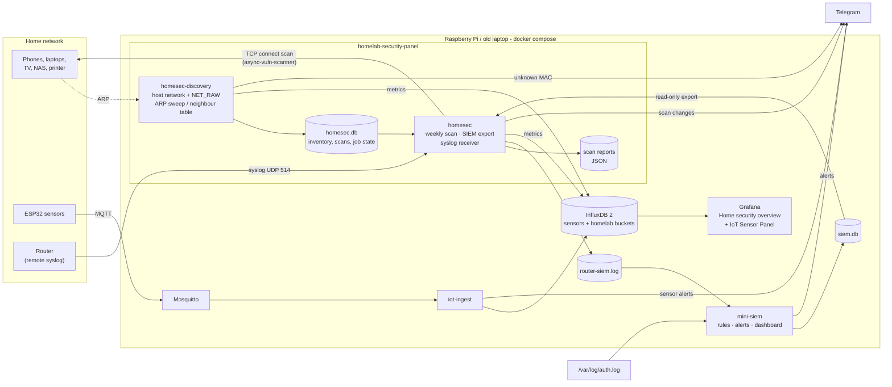

# homelab-security-panel

[](https://github.com/rosko35/homelab-security-panel/actions/workflows/ci.yml)


A home network security panel for a Raspberry Pi or an old laptop. It ties
three of my earlier projects into one deployment and adds the glue they were
missing:

- **New device alerts**: it keeps an inventory of every MAC address on the
  LAN and sends a Telegram message when an unknown one shows up.
- **Weekly port scans** of everything in that inventory, diffed against the
  previous week: newly opened ports, changed service versions, new CVEs.
- **Log monitoring** of the Pi itself *and* the router, through a small syslog
  receiver that feeds the router's SSH events into the SIEM.
- **One Grafana** for all of it, next to the sensor dashboard I already had.

Everything is started with one `docker compose up`, everything listens on
`127.0.0.1` unless you decide otherwise, and all alerts go to one Telegram chat.

| Home security overview | New device on the Wi-Fi |
| --- | --- |
| *Screenshot placeholder: `docs/img/overview-dashboard.png` (not recorded yet)* | *Screenshot placeholder: `docs/img/new-device-telegram.png` (not recorded yet)* |

See [docs/img/README.md](docs/img/README.md) for what each image will show.

> [!IMPORTANT]
> **Only monitor networks you own or administer, and tell the people you share
> them with.** This panel records which devices are online and when, scans
> them, and reads router logs. On a shared home network that is information
> about your family, flatmates and guests. Tell them it is running, keep the
> retention short, and do not point it at networks that are not yours (your
> employer's, your landlord's, a café's): scanning or monitoring them can be
> illegal and is a breach of trust either way.

## Architecture



## What each sub-project contributes

| Project | Role in the homelab | Used as |
| --- | --- | --- |
| [async-vuln-scanner](https://github.com/rosko35/async-vuln-scanner) | ARP discovery (`vulnscan.discovery`), the asyncio TCP scan with banner/version detection and NVD CVE lookup (`vulnscan.engine.run_scan`), JSON reports and the scan diff (`vulnscan.diff.diff_scans`) | Python library, installed into the `homesec` images |
| [mini-siem](https://github.com/rosko35/mini-siem) | Tails the Pi's `auth.log` and the router feed, runs the YAML rules (plus [`siem/rules/router.yml`](siem/rules/router.yml) from this repo), stores events and alerts in SQLite, Telegram alerts, its own dashboard | Its own container, built from its repository |
| [iot-sensor-panel](https://github.com/rosko35/iot-sensor-panel) | Mosquitto, the MQTT ingest service, InfluxDB 2, the Grafana datasource and the IoT dashboard; the optional simulator | Its ingest image, built from its repository; its InfluxDB and Grafana setup is reused here |
| **this repository** | Device inventory and new-device alerts, the scan schedule and diff alerts, the router syslog receiver, the mini-siem exporter, the shared Grafana dashboard and the compose file | `homesec` CLI / two small containers |

## Quick start

Requirements: a Linux machine (Raspberry Pi OS 64-bit, Debian, Ubuntu) with
Docker Engine and Compose v2.17 or newer. Docker Desktop on macOS/Windows runs
containers inside a VM, so `network_mode: host` there is not your LAN and
device discovery will not see real devices; use a Linux host.

```bash
git clone https://github.com/rosko35/homelab-security-panel.git
cd homelab-security-panel
python3 scripts/init_env.py          # .env with random InfluxDB/Grafana secrets
nano .env                            # HOMESEC_NETWORKS, Telegram bot (optional)
docker compose up -d --build
```

Then open <http://127.0.0.1:3000> on the Pi (or through an SSH tunnel,
`ssh -L 3000:127.0.0.1:3000 pi@raspberrypi.local`). The user is `admin`, the
password is `GRAFANA_ADMIN_PASSWORD` from `.env`. The **Home security overview**
is the home dashboard; the IoT dashboard is in the *IoT* folder.

What happens next:

1. Within a minute `homesec-discovery` records every device it finds and sends
   **one** summary message ("inventory initialised with N devices"), not one
   alert per device.
2. Mark the devices you recognise:

   ```bash
   docker compose exec homesec homesec devices list
   docker compose exec homesec homesec devices known 3c:a6:2f:12:34:56 --label router
   docker compose exec homesec homesec devices known 192.168.1.23 --label "living room TV"
   ```

   From now on every MAC that is not in the inventory triggers an alert.
3. The first port scan runs right away and becomes the baseline; after that
   it runs weekly (`scan.interval`), and only changes are reported.

Want the sensor dashboard to show something without real ESP32s?
`docker compose --profile simulator up -d` adds four simulated sensors.

| Service | Address | Notes |
| --- | --- | --- |
| Grafana | `127.0.0.1:3000` | `GRAFANA_BIND` to expose, see below |
| mini-siem dashboard | `127.0.0.1:8080` | optional basic auth via `SIEM_DASHBOARD_USER/PASSWORD` |
| InfluxDB | `127.0.0.1:8086` | admin user from `.env` |
| MQTT | `127.0.0.1:1883` | `MQTT_BIND` to expose (read the warning in `mosquitto/mosquitto.conf` first) |
| Router syslog | `127.0.0.1:514/udp` | `SYSLOG_BIND` to receive from the router |

### Building from local checkouts

The sibling projects are built from GitHub by default. To build from local
clones next to this one (useful while changing them), add to `.env`:

```bash
SCANNER_SRC=../async-vuln-scanner
SIEM_SRC=../mini-siem
IOT_SRC=../iot-sensor-panel
```

## Router logs

Most routers can send their log to a "remote syslog server". Point it at the
Pi's LAN address, UDP port 514, and let the receiver listen there:

```bash
# .env
SYSLOG_BIND=192.168.1.10        # the Pi's address on the LAN
docker compose up -d homesec
```

OpenWrt, for example:

```sh
uci set system.@system[0].log_ip='192.168.1.10'
uci set system.@system[0].log_port='514'
uci set system.@system[0].log_proto='udp'
uci commit system && /etc/init.d/log restart
```

The receiver accepts RFC 3164 and RFC 5424, drops senders outside
`syslog.allowed_senders` (private ranges by default; narrow it to the router's
address) and writes two files to the `router-logs` volume:

- `router.log`: every message, one line each, for you.
- `router-siem.log`: SSH events only, in the format mini-siem's `auth` parser
  reads, hostname normalised to `router`. Dropbear (the SSH server on OpenWrt
  and many embedded routers) is translated to OpenSSH wording, because
  mini-siem only parses sshd. CR/LF and control characters are stripped, so a
  datagram cannot inject extra lines into a file the SIEM trusts.

[`siem/rules/router.yml`](siem/rules/router.yml) adds four rules on top of
mini-siem's defaults: failed router logins (3 in 5 minutes), username guessing,
any shell login on the router, and a login right after failures. They only
match `host: router`, so the Pi's own SSH log keeps using mini-siem's rules.

## Exposing Grafana on the LAN

By default nothing in this stack is reachable from another machine. To open
Grafana to the LAN on purpose:

1. Make sure `GRAFANA_ADMIN_PASSWORD` is a strong, unique password.
2. Set `GRAFANA_BIND` in `.env` to the Pi's LAN address (prefer the specific
   address over `0.0.0.0`, which would also cover VPN and Docker interfaces):

   ```bash
   GRAFANA_BIND=192.168.1.10
   ```

3. `docker compose up -d grafana` and browse to `http://192.168.1.10:3000`.

Never forward the port on your router. For access from outside, use a VPN
(WireGuard, Tailscale) or an SSH tunnel. Grafana speaks plain HTTP here; on a
LAN you share with others, put a TLS reverse proxy in front of it.

## Running without Docker

Python 3.11+. The sibling projects are not on PyPI, so install them first:

```bash
python -m venv .venv && source .venv/bin/activate     # Windows: .venv\Scripts\activate
pip install -r requirements/siblings-local.txt        # editable, from ../async-vuln-scanner, ../mini-siem
# or: pip install -r requirements/siblings-git.txt    # from GitHub
pip install -e ".[dev]"                               # + ".[arp]" for Scapy ARP sweeps
pytest
```

```text
homesec run [--only discovery,scan,siem_export,syslog]   all enabled jobs on their schedule
homesec discover [--once]                                device discovery (+ new-device alerts)
homesec scan [--once]                                    port scan of the inventory (+ diff alerts)
homesec export-siem [--once]                             mini-siem -> InfluxDB
homesec syslog                                           router syslog receiver only
homesec devices list [--unknown] [--json]
homesec devices known <MAC|IP> [--label NAME]            also: unknown, label, forget
homesec status                                           last job runs and scans
homesec check-config
```

Without root (or `CAP_NET_RAW`) and Scapy, discovery falls back to the
operating system's neighbour table (`ip neigh`, `/proc/net/arp`, `arp -a` on
Windows/macOS/BSD). That sends no packets at all, but it only lists devices
the machine recently talked to.

## Configuration

[`config/homesec.yml`](config/homesec.yml) is commented and holds everything
that is not a secret: networks, intervals (`300`, `"5m"`, `"7d"`), the scan's
port list, rate and exclusions, which change kinds alert, the syslog allowlist,
InfluxDB bucket and retention. Secrets only come from the environment:
`TELEGRAM_BOT_TOKEN`, `TELEGRAM_CHAT_ID`, `INFLUX_TOKEN`, `NVD_API_KEY`. A
token in the YAML file is rejected on purpose.

Scheduling is in-process (one asyncio loop, no cron). The time of each job's
last run is kept in SQLite, so a weekly scan stays weekly across restarts.
`docker stop` sends SIGTERM; a running job gets a few seconds to finish and is
otherwise cancelled and repeated after the restart.

### What ends up in InfluxDB (bucket `homelab`)

| Measurement | Tags | Fields |
| --- | --- | --- |
| `homesec_devices` | `method` | `total`, `known`, `unknown`, `online`, `seen`, `new` |
| `homesec_new_device` | `mac`, `vendor` | `ip`, `value` |
| `homesec_device` | `mac`, `name`, `known` | `ip`, `online` |
| `homesec_scan` | | `hosts_scanned`, `hosts_with_ports`, `open_ports`, `unique_cves`, `changes`, `alerts`, `duration_s` |
| `homesec_scan_host` | `host`, `mac`, `name` | `open_ports`, `cves` |
| `homesec_scan_port` | `host`, `name`, `port`, `service` | `product`, `cves`, `max_severity` |
| `homesec_scan_cves` | `severity` | `count` |
| `homesec_scan_change` | `kind`, `host`, `port` | `message`, `alert` |
| `siem_alerts` | `rule_id`, `rule_name`, `severity` | `alerts`, `events` (hourly buckets) |
| `siem_events` | `type` | `count`, `suspicious` (hourly buckets) |
| `siem_summary` | | `events_24h`, `alerts_24h`, `ssh_attempts_24h`, `attacker_ips_24h`, `high_alerts_24h`, `last_event_age_s` |

The SIEM exporter opens mini-siem's database with SQLite's `mode=ro` and
rewrites the last 48 hourly buckets every minute; same series and timestamp
means InfluxDB overwrites, so nothing is double counted.

## Hardware notes

| | Raspberry Pi 4 / 5 (4 GB+) | Raspberry Pi 3 / 2 GB boards | Old laptop |
| --- | --- | --- | --- |
| Works? | Yes, the target | Tight: skip the simulator, consider a shorter Influx retention | Yes, any x86_64 with Debian/Ubuntu |
| Notes | 64-bit Raspberry Pi OS (InfluxDB 2 has no 32-bit ARM image) | Expect slow Grafana | Disable suspend on lid close; the battery doubles as a UPS |

- **Images**: every image used (`python:3.12-slim-bookworm`, `influxdb:2.7.11`,
  `grafana/grafana-oss:11.4.0`, `eclipse-mosquitto:2.0.20`) is published for
  `linux/arm64` and `linux/amd64`, so the same compose file works on both.
- **Memory**: the compose file sets `mem_limit`/`cpus` for every service.
  Together the limits add up to roughly 1.9 GB; typical use is well below.
  InfluxDB gets the largest share (768 MB).
- **Storage**: run Docker's data directory from a USB SSD rather than the SD
  card. InfluxDB and SQLite write constantly, and SD cards wear out.
- **Network**: wired Ethernet. ARP discovery covers the layer-2 segment the Pi
  is on; devices behind a second router or in a guest VLAN are invisible.
- **Raspberry Pi OS Bookworm** logs SSH to journald only. Install rsyslog
  (`sudo apt install rsyslog`) so `/var/log/auth.log` exists for mini-siem.

## Security design

- **Nothing exposed by default.** Every published port is bound to
  `127.0.0.1`; `GRAFANA_BIND`, `SYSLOG_BIND` and `MQTT_BIND` open them one by
  one. A test parses the compose file and fails if a port escapes loopback.
- **Privilege in one small place.** ARP needs raw sockets on the real LAN, so
  `homesec-discovery` runs with `network_mode: host` and `CAP_NET_RAW` and
  nothing else. It runs as an unprivileged user: only a copy of the Python
  interpreter in that image carries the `cap_net_raw` file capability, which
  is why `no-new-privileges` is off for that one container. It publishes no
  ports and only does discovery. The scanner, exporter and syslog receiver run
  in a separate container with `cap_drop: ALL` on the bridge network (a TCP
  connect scan needs no privileges).
- **Read-only where possible**: read-only root filesystems, `/var/log` and the
  router feed mounted read-only into mini-siem, mini-siem's database opened
  with `mode=ro` by the exporter.
- **Secrets**: never in git, never defaulted. Compose refuses to start
  without `INFLUX_TOKEN`, `INFLUX_ADMIN_PASSWORD` and `GRAFANA_ADMIN_PASSWORD`;
  `scripts/init_env.py` generates them. The Telegram token is never logged
  (httpx request logging is muted because the token is part of the URL).
- **Gentle scanning**: rate limited (`scan.rate`), weekly, and limited to
  devices discovery actually saw. Cheap IoT devices sometimes crash when
  probed; put them in `scan.exclude`.

## Tests and CI

```bash
pytest          # 128 tests, a few seconds, no network access beyond 127.0.0.1
ruff check . && ruff format --check .
```

- Inventory and new-device detection (first-run baseline, retries when
  Telegram is down, DHCP address changes).
- Neighbour-table parsers with sample output from Linux `ip neigh`,
  `/proc/net/arp`, Windows `arp -a` (including a localised header) and
  macOS/net-tools `arp -a`.
- Syslog receiver: RFC 3164/5424 parsing, dropbear translation, log
  injection, rotation, and real UDP datagrams to `127.0.0.1` on an ephemeral port.
- Scan job: a real scan with the scanner's models against asyncio services on
  `127.0.0.1` whose banners change between scans, with the NVD API mocked;
  checks the new-port, version-change and new-CVE alerts.
- SIEM exporter against a database created by mini-siem's own `SQLiteStorage`.
- Router rules loaded by mini-siem's rule loader and executed by its parser
  and rule engine.
- Telegram notifier with a mocked HTTP transport.
- Compose file, Grafana provisioning and dashboard JSON (loopback-only ports,
  privilege isolation, measurement names, panel layout).

GitHub Actions runs ruff and pytest on Python 3.11 to 3.13 with the sibling
projects installed from their GitHub repositories, plus `docker compose config`.

## Limitations

- Randomised ("private") Wi-Fi MAC addresses: phones may show up as a new
  device per network or after a reset. They are labelled
  `randomized (private address)`; mark them known once.
- The bundled vendor table is a small hand-picked subset; point
  `discovery.oui_file` at the IEEE's full `oui.csv` for better names.
- The neighbour-table fallback is passive and misses quiet devices.
- mini-siem only parses SSH and nginx logs, so router firewall or DHCP lines
  end up in `router.log` but do not reach the SIEM rules.
- CVE matching is by product and version string from the banner; distribution
  backports (e.g. Debian patching OpenSSH without changing the version)
  produce false positives.

## The homelab story

### Why I built this

I had built three separate things: a port scanner, a small SIEM for a VPS and
a sensor dashboard. Each one worked, but at home they lived on three different
machines with three dashboards and three ways of telling me something was
wrong. What I actually wanted to know about my own network was simple: *is
there a device here I don't know, did something start listening that wasn't
listening last week, and is anyone trying passwords on my router?* None of the
three projects could answer that alone, but together they had almost all the
parts. This repository is the glue, and the one-command deployment that makes
an old Raspberry Pi into the place where all of it runs.

### What I learned

- **IP addresses are a bad identity at home.** My scanner's diff compares
  hosts by IP, which is right for servers and wrong for a home network: when
  DHCP hands a device a new address, the diff reports one host vanishing and
  a new one appearing. Re-keying the scan results by MAC address before
  diffing solves that without changing the scanner.
- **"Unknown device" alerts need a baseline.** The first run would otherwise
  send an alert for every device in the house. One summary message and a
  `devices known` command made it something I would actually keep enabled.
- **Least privilege takes real effort in Docker.** ARP needs raw sockets on the
  host network. Giving the whole app that was easy; confining it to one tiny
  container running as a normal user needed a file capability on a copy of
  the interpreter, and I learned that `no-new-privileges` silently cancels
  file capabilities.
- **Glue code is about formats.** The router speaks dropbear, mini-siem
  understands sshd; syslog has two RFCs and many dialects; Grafana needs the
  data in InfluxDB, not SQLite. Most of the work was translating carefully,
  including making sure a crafted syslog packet cannot write fake lines into a
  file the SIEM trusts.
- **SQLite WAL readers are not quite read-only.** A reader still needs the
  shared-memory file next to the database, which changed how I mounted
  mini-siem's volume into the exporter.
- **A home network is shared.** Building a tool that knows when every phone
  in the house comes and goes made me think about who else lives on that
  network. That is why the README starts with a note to tell them.

## License

[MIT](LICENSE) © 2026 Emre Özaydın
