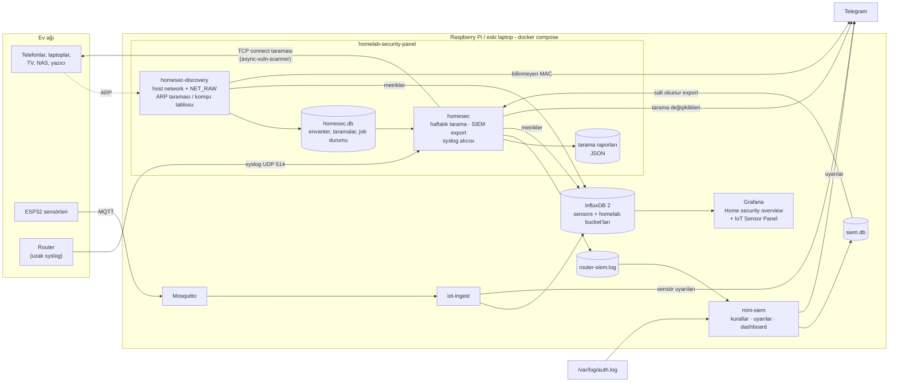

# homelab-security-panel

🇬🇧 [English](README.md)

[](https://github.com/rosko35/homelab-security-panel/actions/workflows/ci.yml)


Raspberry Pi ya da eski bir laptop için ev ağı güvenlik paneli. Daha önce
yaptığım üç projeyi tek bir kurulumda birleştiriyor ve aralarında eksik olan
bağlantı katmanını ekliyor:

- **Yeni cihaz uyarıları**: Yerel ağdaki (LAN) her MAC adresinin envanterini
  tutar; bilinmeyen bir cihaz ağa girince Telegram mesajı gönderir.
- **Haftalık port taraması**: Envanterdeki her cihaz taranır ve sonuç bir önceki
  haftayla karşılaştırılır: yeni açılan portlar, değişen servis sürümleri, yeni
  CVE'ler (bilinen güvenlik açığı kayıtları).
- **Log izleme**: Hem Pi'nin kendisi hem de router için; router'ın SSH
  olaylarını SIEM'e (güvenlik olaylarını toplayıp analiz eden sistem) aktaran
  küçük bir syslog alıcısı üzerinden yapılır.
- **Hepsi için tek Grafana**: Zaten sahip olduğum sensör panosunun yanında.

Her şey tek bir `docker compose up` ile başlar, siz aksini istemedikçe her şey
yalnızca `127.0.0.1` üzerinde dinler ve bütün uyarılar tek bir Telegram
sohbetine gider.

| Ev güvenliği genel görünümü | Wi-Fi'da yeni cihaz |
| --- | --- |
| *Ekran görüntüsü yer tutucusu: `docs/img/overview-dashboard.png` (henüz kaydedilmedi)* | *Ekran görüntüsü yer tutucusu: `docs/img/new-device-telegram.png` (henüz kaydedilmedi)* |

Her görselin neyi göstereceği için [docs/img/README.tr.md](docs/img/README.tr.md)
dosyasına bakın.

> [!IMPORTANT]
> **Yalnızca sahibi ya da yöneticisi olduğunuz ağları izleyin ve ağı paylaştığınız
> kişilere bunu söyleyin.** Bu panel hangi cihazların ne zaman çevrimiçi
> olduğunu kaydeder, cihazları tarar ve router loglarını okur. Ortak kullanılan
> bir ev ağında bu, ailenizle, ev arkadaşlarınızla ve misafirlerinizle ilgili
> bilgidir. Çalıştığını onlara söyleyin, verileri kısa süre saklayın ve panoyu
> size ait olmayan ağlara (işvereninizin, ev sahibinizin, bir kafenin ağı)
> yöneltmeyin: bu ağları taramak ya da izlemek yasa dışı olabilir ve her
> durumda bir güven ihlalidir.

## Mimari



## Her alt proje ne katıyor

| Proje | Homelab'daki rolü | Nasıl kullanılıyor |
| --- | --- | --- |
| [async-vuln-scanner](https://github.com/rosko35/async-vuln-scanner) | ARP ile cihaz keşfi (`vulnscan.discovery`), banner/sürüm tespiti ve NVD CVE sorgusu yapan asyncio TCP taraması (`vulnscan.engine.run_scan`), JSON raporları ve tarama farkı (`vulnscan.diff.diff_scans`) | Python kütüphanesi olarak `homesec` image'larına kurulur |
| [mini-siem](https://github.com/rosko35/mini-siem) | Pi'nin `auth.log` dosyasını ve router akışını takip eder, YAML kurallarını çalıştırır (bu repodaki [`siem/rules/router.yml`](siem/rules/router.yml) dahil), olayları ve uyarıları SQLite'ta saklar, Telegram uyarıları gönderir, kendi dashboard'u vardır | Kendi container'ı; kendi reposundan build edilir |
| [iot-sensor-panel](https://github.com/rosko35/iot-sensor-panel) | Mosquitto, MQTT ingest servisi, InfluxDB 2, Grafana veri kaynağı ve IoT panosu; isteğe bağlı simülatör | Kendi reposundan build edilen ingest image'ı; InfluxDB ve Grafana kurulumu burada yeniden kullanılır |
| **bu repo** | Cihaz envanteri ve yeni cihaz uyarıları, tarama takvimi ve fark uyarıları, router syslog alıcısı, mini-siem exporter'ı, ortak Grafana panosu ve compose dosyası | `homesec` CLI / iki küçük container |

## Hızlı başlangıç

Gereksinimler: Docker Engine ve Compose v2.17 veya daha yenisi kurulu bir Linux
makine (Raspberry Pi OS 64-bit, Debian, Ubuntu). macOS/Windows üzerindeki Docker
Desktop container'ları bir sanal makine (VM) içinde çalıştırır; bu yüzden orada
`network_mode: host` sizin LAN'ınız değildir ve cihaz keşfi gerçek cihazları
göremez. Linux bir makine kullanın.

```bash
git clone https://github.com/rosko35/homelab-security-panel.git
cd homelab-security-panel
python3 scripts/init_env.py          # rastgele InfluxDB/Grafana sırlarıyla .env oluşturur
nano .env                            # HOMESEC_NETWORKS, Telegram botu (isteğe bağlı)
docker compose up -d --build
```

Sonra Pi üzerinde <http://127.0.0.1:3000> adresini açın (ya da bir SSH tüneliyle,
`ssh -L 3000:127.0.0.1:3000 pi@raspberrypi.local`). Kullanıcı adı `admin`, şifre
ise `.env` içindeki `GRAFANA_ADMIN_PASSWORD` değeridir. **Home security
overview** ana sayfa panosudur; IoT panosu *IoT* klasöründedir.

Bundan sonra olanlar:

1. Bir dakika içinde `homesec-discovery` bulduğu her cihazı kaydeder ve cihaz
   başına bir uyarı yerine **tek bir** özet mesaj gönderir ("inventory
   initialised with N devices").
2. Tanıdığınız cihazları işaretleyin:

   ```bash
   docker compose exec homesec homesec devices list
   docker compose exec homesec homesec devices known 3c:a6:2f:12:34:56 --label router
   docker compose exec homesec homesec devices known 192.168.1.23 --label "living room TV"
   ```

   Bundan sonra envanterde olmayan her MAC adresi bir uyarı tetikler.
3. İlk port taraması hemen çalışır ve başlangıç referansı (baseline) olur; sonra
   haftada bir çalışır (`scan.interval`) ve yalnızca değişiklikler raporlanır.

Sensör panosunda gerçek ESP32 olmadan da bir şeyler görmek ister misiniz?
`docker compose --profile simulator up -d` dört simüle sensör ekler.

| Servis | Adres | Notlar |
| --- | --- | --- |
| Grafana | `127.0.0.1:3000` | Dışarı açmak için `GRAFANA_BIND`, aşağıya bakın |
| mini-siem dashboard | `127.0.0.1:8080` | `SIEM_DASHBOARD_USER/PASSWORD` ile isteğe bağlı basic auth |
| InfluxDB | `127.0.0.1:8086` | `.env` içindeki admin kullanıcısı |
| MQTT | `127.0.0.1:1883` | Dışarı açmak için `MQTT_BIND` (önce `mosquitto/mosquitto.conf` içindeki uyarıyı okuyun) |
| Router syslog | `127.0.0.1:514/udp` | Router'dan log almak için `SYSLOG_BIND` |

### Yerel kopyalardan build etme

Kardeş projeler varsayılan olarak GitHub'dan build edilir. Bu reponun yanındaki
yerel klonlardan build etmek için (onları değiştirirken işe yarar) `.env`
dosyasına şunları ekleyin:

```bash
SCANNER_SRC=../async-vuln-scanner
SIEM_SRC=../mini-siem
IOT_SRC=../iot-sensor-panel
```

## Router logları

Çoğu router logunu bir "uzak syslog sunucusuna" gönderebilir. Onu Pi'nin LAN
adresine, UDP 514 portuna yönlendirin ve alıcının orada dinlemesini sağlayın:

```bash
# .env
SYSLOG_BIND=192.168.1.10        # Pi'nin LAN'daki adresi
docker compose up -d homesec
```

Örneğin OpenWrt'de:

```sh
uci set system.@system[0].log_ip='192.168.1.10'
uci set system.@system[0].log_port='514'
uci set system.@system[0].log_proto='udp'
uci commit system && /etc/init.d/log restart
```

Alıcı RFC 3164 ve RFC 5424 formatlarını kabul eder, `syslog.allowed_senders`
dışındaki gönderenleri reddeder (varsayılan olarak özel IP aralıkları; bunu
router'ın adresine daraltın) ve `router-logs` volume'üne iki dosya yazar:

- `router.log`: Her mesaj, satır başına bir tane; sizin okumanız için.
- `router-siem.log`: Yalnızca SSH olayları; mini-siem'in `auth` parser'ının
  okuduğu formatta, hostname `router` olarak normalleştirilmiş halde. Dropbear
  (OpenWrt'de ve birçok gömülü router'da kullanılan SSH sunucusu) OpenSSH
  ifadelerine çevrilir, çünkü mini-siem yalnızca sshd'yi parse eder. CR/LF ve
  kontrol karakterleri temizlenir; böylece tek bir datagram, SIEM'in güvendiği
  bir dosyaya fazladan satır enjekte edemez.

[`siem/rules/router.yml`](siem/rules/router.yml), mini-siem'in varsayılan
kurallarının üstüne dört kural ekler: başarısız router girişleri (5 dakikada 3),
kullanıcı adı tahmini, router'a yapılan herhangi bir shell girişi ve başarısız
denemelerin hemen ardından gelen bir giriş. Bu kurallar yalnızca `host: router`
ile eşleşir; Pi'nin kendi SSH logu mini-siem'in kurallarını kullanmaya devam
eder.

## Grafana'yı LAN'a açma

Varsayılan olarak bu yığındaki hiçbir şeye başka bir makineden erişilemez.
Grafana'yı bilerek LAN'a açmak için:

1. `GRAFANA_ADMIN_PASSWORD` değerinin güçlü ve benzersiz bir şifre olduğundan
   emin olun.
2. `.env` içinde `GRAFANA_BIND` değerini Pi'nin LAN adresine ayarlayın
   (VPN ve Docker arayüzlerini de kapsayacak olan `0.0.0.0` yerine belirli adresi
   tercih edin):

   ```bash
   GRAFANA_BIND=192.168.1.10
   ```

3. `docker compose up -d grafana` çalıştırın ve `http://192.168.1.10:3000`
   adresine gidin.

Portu asla router'ınızdan dışarıya yönlendirmeyin. Dışarıdan erişim için VPN
(WireGuard, Tailscale) ya da SSH tüneli kullanın. Grafana burada düz HTTP
konuşur; başkalarıyla paylaştığınız bir LAN'da önüne TLS'li bir reverse proxy
koyun.

## Docker olmadan çalıştırma

Python 3.11+. Kardeş projeler PyPI'da olmadığı için önce onları kurun:

```bash
python -m venv .venv && source .venv/bin/activate     # Windows: .venv\Scripts\activate
pip install -r requirements/siblings-local.txt        # editable, ../async-vuln-scanner ve ../mini-siem'den
# veya: pip install -r requirements/siblings-git.txt  # GitHub'dan
pip install -e ".[dev]"                               # + Scapy ARP taramaları için ".[arp]"
pytest
```

```text
homesec run [--only discovery,scan,siem_export,syslog]   etkin tüm job'lar, kendi takvimlerinde
homesec discover [--once]                                cihaz keşfi (+ yeni cihaz uyarıları)
homesec scan [--once]                                    envanterin port taraması (+ fark uyarıları)
homesec export-siem [--once]                             mini-siem -> InfluxDB
homesec syslog                                           yalnızca router syslog alıcısı
homesec devices list [--unknown] [--json]
homesec devices known <MAC|IP> [--label NAME]            ayrıca: unknown, label, forget
homesec status                                           son job çalışmaları ve taramalar
homesec check-config
```

root yetkisi (ya da `CAP_NET_RAW`) ve Scapy olmadan cihaz keşfi, işletim
sisteminin komşu tablosuna (neighbour table) geri döner (`ip neigh`,
`/proc/net/arp`, Windows/macOS/BSD'de `arp -a`). Bu yöntem hiç paket
göndermez, ama yalnızca makinenin yakın zamanda konuştuğu cihazları listeler.

## Yapılandırma

[`config/homesec.yml`](config/homesec.yml) açıklamalıdır ve sır olmayan her şeyi
içerir: ağlar, aralıklar (`300`, `"5m"`, `"7d"`), taramanın port listesi, hızı ve
hariç tutulanlar, hangi değişiklik türlerinin uyarı vereceği, syslog izin
listesi, InfluxDB bucket'ı ve saklama süresi. Sırlar yalnızca ortam
değişkenlerinden gelir: `TELEGRAM_BOT_TOKEN`, `TELEGRAM_CHAT_ID`, `INFLUX_TOKEN`,
`NVD_API_KEY`. YAML dosyasındaki bir token bilerek reddedilir.

Zamanlama süreç içindedir (tek bir asyncio döngüsü, cron yok). Her job'ın son
çalışma zamanı SQLite'ta tutulur; böylece haftalık bir tarama yeniden
başlatmalarda da haftalık kalır. `docker stop` SIGTERM gönderir; çalışan bir
job'a bitirmesi için birkaç saniye tanınır, bitmezse iptal edilir ve yeniden
başlatmadan sonra tekrarlanır.

### InfluxDB'ye neler yazılıyor (`homelab` bucket'ı)

| Measurement | Tag'ler | Alanlar |
| --- | --- | --- |
| `homesec_devices` | `method` | `total`, `known`, `unknown`, `online`, `seen`, `new` |
| `homesec_new_device` | `mac`, `vendor` | `ip`, `value` |
| `homesec_device` | `mac`, `name`, `known` | `ip`, `online` |
| `homesec_scan` | | `hosts_scanned`, `hosts_with_ports`, `open_ports`, `unique_cves`, `changes`, `alerts`, `duration_s` |
| `homesec_scan_host` | `host`, `mac`, `name` | `open_ports`, `cves` |
| `homesec_scan_port` | `host`, `name`, `port`, `service` | `product`, `cves`, `max_severity` |
| `homesec_scan_cves` | `severity` | `count` |
| `homesec_scan_change` | `kind`, `host`, `port` | `message`, `alert` |
| `siem_alerts` | `rule_id`, `rule_name`, `severity` | `alerts`, `events` (saatlik bucket'lar) |
| `siem_events` | `type` | `count`, `suspicious` (saatlik bucket'lar) |
| `siem_summary` | | `events_24h`, `alerts_24h`, `ssh_attempts_24h`, `attacker_ips_24h`, `high_alerts_24h`, `last_event_age_s` |

SIEM exporter'ı mini-siem'in veritabanını SQLite'ın `mode=ro` ayarıyla açar ve
her dakika son 48 saatlik bucket'ı yeniden yazar; aynı seri ve aynı zaman
damgası InfluxDB'nin üzerine yazması anlamına geldiği için hiçbir şey iki kez
sayılmaz.

## Donanım notları

| | Raspberry Pi 4 / 5 (4 GB+) | Raspberry Pi 3 / 2 GB'lık kartlar | Eski laptop |
| --- | --- | --- | --- |
| Çalışır mı? | Evet, hedef donanım bu | Sınırda: simülatörü atlayın, daha kısa bir Influx saklama süresi düşünün | Evet, Debian/Ubuntu çalıştıran herhangi bir x86_64 |
| Notlar | 64-bit Raspberry Pi OS (InfluxDB 2'nin 32-bit ARM image'ı yok) | Grafana'nın yavaş olmasını bekleyin | Kapak kapanınca askıya almayı kapatın; pil bir UPS görevi görür |

- **Image'lar**: Kullanılan her image (`python:3.12-slim-bookworm`,
  `influxdb:2.7.11`, `grafana/grafana-oss:11.4.0`, `eclipse-mosquitto:2.0.20`)
  `linux/arm64` ve `linux/amd64` için yayımlanmıştır; yani aynı compose dosyası
  ikisinde de çalışır.
- **Bellek**: Compose dosyası her servis için `mem_limit`/`cpus` ayarlar. Limitler
  toplamda yaklaşık 1,9 GB eder; tipik kullanım bunun çok altındadır. En büyük
  payı InfluxDB alır (768 MB).
- **Depolama**: Docker'ın veri dizinini SD kart yerine bir USB SSD'den çalıştırın.
  InfluxDB ve SQLite sürekli yazar, SD kartlar ise yıpranır.
- **Ağ**: Kablolu Ethernet. ARP keşfi, Pi'nin bulunduğu katman-2 segmentini
  kapsar; ikinci bir router'ın arkasındaki ya da misafir VLAN'ındaki cihazlar
  görünmez.
- **Raspberry Pi OS Bookworm** SSH loglarını yalnızca journald'a yazar. mini-siem
  için `/var/log/auth.log` dosyasının var olması adına rsyslog kurun
  (`sudo apt install rsyslog`).

## Güvenlik tasarımı

- **Varsayılan olarak hiçbir şey dışarı açık değil.** Yayımlanan her port
  `127.0.0.1`'e bağlıdır; `GRAFANA_BIND`, `SYSLOG_BIND` ve `MQTT_BIND` bunları
  tek tek açar. Bir test compose dosyasını parse eder ve herhangi bir port
  loopback'ten çıkarsa başarısız olur.
- **Yetki tek bir küçük yerde.** ARP, gerçek LAN üzerinde raw socket gerektirir;
  bu yüzden `homesec-discovery` `network_mode: host` ve `CAP_NET_RAW` ile,
  başka hiçbir şey olmadan çalışır. Yetkisiz bir kullanıcı olarak çalışır: o
  image'da yalnızca Python yorumlayıcısının bir kopyası `cap_net_raw` dosya
  yetkisini (file capability) taşır; bu yüzden yalnızca o container için
  `no-new-privileges` kapalıdır. Hiçbir port yayımlamaz ve yalnızca cihaz keşfi
  yapar. Tarayıcı, exporter ve syslog alıcısı ise bridge ağında, `cap_drop: ALL`
  ile ayrı bir container'da çalışır (TCP connect taraması yetki gerektirmez).
- **Mümkün olan her yerde salt okunur**: salt okunur root dosya sistemleri,
  mini-siem'e salt okunur bağlanan `/var/log` ve router akışı, exporter'ın
  `mode=ro` ile açtığı mini-siem veritabanı.
- **Sırlar**: Asla git'te değil, asla varsayılan değerli değil. Compose,
  `INFLUX_TOKEN`, `INFLUX_ADMIN_PASSWORD` ve `GRAFANA_ADMIN_PASSWORD` olmadan
  başlamayı reddeder; `scripts/init_env.py` bunları üretir. Telegram token'ı asla
  loglanmaz (token URL'nin bir parçası olduğu için httpx istek logları
  kapatılmıştır).
- **Nazik tarama**: Hız sınırlı (`scan.rate`), haftalık ve yalnızca keşfin
  gerçekten gördüğü cihazlarla sınırlı. Ucuz IoT cihazları yoklanınca bazen
  çöker; onları `scan.exclude` içine koyun.

## Testler ve CI

```bash
pytest          # 128 test, birkaç saniye, 127.0.0.1 dışında ağ erişimi yok
ruff check . && ruff format --check .
```

- Envanter ve yeni cihaz tespiti (ilk çalıştırma baseline'ı, Telegram
  erişilemezken yeniden deneme, DHCP adres değişiklikleri).
- Linux `ip neigh`, `/proc/net/arp`, Windows `arp -a` (yerelleştirilmiş bir
  başlık dahil) ve macOS/net-tools `arp -a` örnek çıktılarıyla komşu tablosu
  parser'ları.
- Syslog alıcısı: RFC 3164/5424 parse etme, dropbear çevirisi, log enjeksiyonu,
  log rotasyonu ve geçici bir portta `127.0.0.1`'e gönderilen gerçek UDP
  datagramları.
- Tarama job'ı: tarayıcının kendi modelleriyle, banner'ları taramalar arasında
  değişen `127.0.0.1` üzerindeki asyncio servislerine karşı yapılan gerçek bir
  tarama; NVD API'si mock'lanmıştır. Yeni port, sürüm değişikliği ve yeni CVE
  uyarılarını kontrol eder.
- mini-siem'in kendi `SQLiteStorage` sınıfıyla oluşturulmuş bir veritabanına
  karşı SIEM exporter'ı.
- mini-siem'in kural yükleyicisiyle yüklenen, parser'ı ve kural motoruyla
  çalıştırılan router kuralları.
- HTTP katmanı mock'lanmış Telegram bildirici.
- Compose dosyası, Grafana provisioning'i ve pano JSON'u (yalnızca loopback
  portları, yetki izolasyonu, measurement adları, panel yerleşimi).

GitHub Actions, kardeş projeler GitHub repolarından kurulmuş halde Python 3.11
ile 3.13 arasında ruff ve pytest çalıştırır, ayrıca `docker compose config`
komutunu da çalıştırır.

## Sınırlamalar

- Rastgele ("özel") Wi-Fi MAC adresleri: telefonlar her ağda ya da sıfırlamadan
  sonra yeni bir cihaz olarak görünebilir. Bunlar
  `randomized (private address)` olarak etiketlenir; bir kez bilinen olarak
  işaretleyin.
- Paketle gelen üretici tablosu elle seçilmiş küçük bir alt kümedir; daha iyi
  isimler için `discovery.oui_file` ayarını IEEE'nin tam `oui.csv` dosyasına
  yönlendirin.
- Komşu tablosu yedeği pasiftir ve sessiz duran cihazları kaçırır.
- mini-siem yalnızca SSH ve nginx loglarını parse eder; bu yüzden router'ın
  güvenlik duvarı ya da DHCP satırları `router.log` içinde kalır ama SIEM
  kurallarına ulaşmaz.
- CVE eşleştirmesi banner'daki ürün ve sürüm metnine göre yapılır; dağıtımların
  geriye dönük yamaları (backport; örneğin Debian'ın OpenSSH'i sürüm numarasını
  değiştirmeden yamalaması) yanlış pozitiflere yol açar.

## Homelab hikâyesi

### Bunu neden yaptım

Üç ayrı şey yapmıştım: bir port tarayıcı, bir VPS için küçük bir SIEM ve bir
sensör panosu. Her biri çalışıyordu, ama evde üç ayrı makinede, üç ayrı panoyla
ve bir şeylerin ters gittiğini söylemenin üç ayrı yoluyla yaşıyorlardı. Kendi
ağım hakkında asıl bilmek istediğim şey basitti: *Burada tanımadığım bir cihaz
var mı, geçen hafta dinlemeyen bir şey dinlemeye başladı mı ve biri router'ıma
şifre denemesi yapıyor mu?* Bu üç projeden hiçbiri tek başına buna cevap
veremiyordu, ama birlikte neredeyse bütün parçalara sahiptiler. Bu repo o bağlantı
katmanı ve eski bir Raspberry Pi'yi hepsinin çalıştığı yere dönüştüren tek
komutluk kurulum.

### Ne öğrendim

- **Evde IP adresi kötü bir kimliktir.** Tarayıcımın diff'i hostları IP'ye göre
  karşılaştırıyor; bu sunucular için doğru, ev ağı için yanlış: DHCP bir cihaza
  yeni adres verince diff bir hostun kaybolduğunu, yeni birinin ortaya çıktığını
  raporluyor. Diff'ten önce tarama sonuçlarını MAC adresine göre yeniden
  anahtarlamak, tarayıcıyı değiştirmeden bunu çözüyor.
- **"Bilinmeyen cihaz" uyarıları bir baseline'a ihtiyaç duyar.** Yoksa ilk
  çalıştırma evdeki her cihaz için bir uyarı gönderirdi. Tek bir özet mesaj ve
  bir `devices known` komutu, bunu gerçekten açık tutacağım bir şey yaptı.
- **Docker'da en az yetki (least privilege) gerçek emek ister.** ARP, host ağında
  raw socket gerektirir. Bunu bütün uygulamaya vermek kolaydı; normal bir
  kullanıcı olarak çalışan tek bir küçük container'a hapsetmek, yorumlayıcının
  bir kopyası üzerinde dosya yetkisi gerektirdi ve `no-new-privileges`
  ayarının dosya yetkilerini sessizce iptal ettiğini öğrendim.
- **Bağlantı kodu biçimlerle ilgilidir.** Router dropbear konuşuyor, mini-siem
  sshd anlıyor; syslog'un iki RFC'si ve çok sayıda lehçesi var; Grafana verinin
  SQLite'ta değil InfluxDB'de olmasını istiyor. İşin çoğu dikkatli çeviri
  yapmaktı; özel hazırlanmış bir syslog paketinin SIEM'in güvendiği bir dosyaya
  sahte satırlar yazamamasını sağlamak da buna dahildi.
- **SQLite WAL okuyucuları tam olarak salt okunur değildir.** Bir okuyucunun
  veritabanının yanında paylaşılan bellek dosyasına yine de ihtiyacı var; bu da
  mini-siem'in volume'ünü exporter'a nasıl bağladığımı değiştirdi.
- **Ev ağı ortaktır.** Evdeki her telefonun ne zaman gelip gittiğini bilen bir
  araç yapmak, o ağda başka kimlerin yaşadığını düşünmemi sağladı. README'nin bu
  yüzden onlara söylemeniz gerektiğini belirten bir notla başlamasının nedeni bu.

## Lisans

[MIT](LICENSE) © 2026 Emre Özaydın
